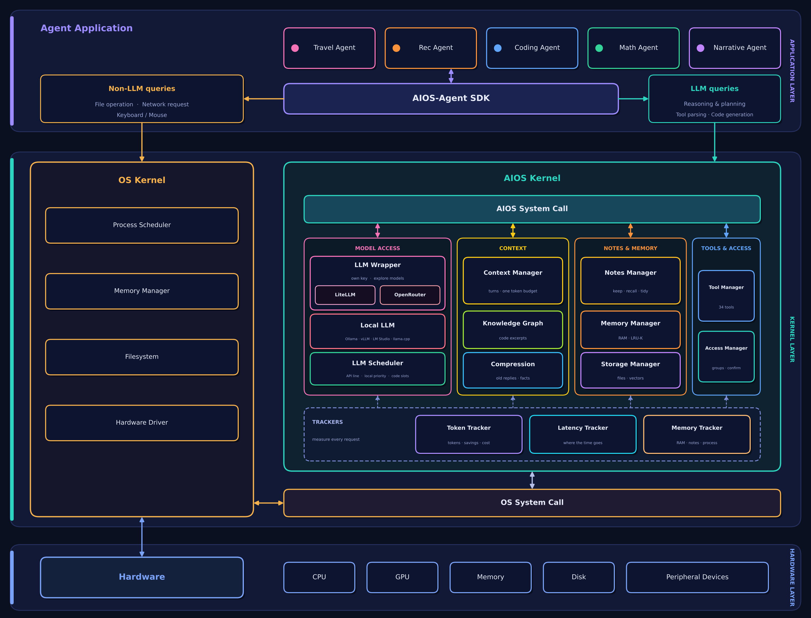

# Pal

Build and plan with AI, in your terminal or your browser, with fewer tokens. Three built-in agents: **Ask**, **Build** and **Plan**.
Underneath is the Pal layer, which cuts tokens and latency: only the relevant history and files are sent, a file the model already has is not
sent again, and long conversations are paged and compressed.

Works with a local model (Ollama) or an API model: Anthropic, OpenAI, Gemini, Groq, DeepSeek, Mistral, Together or OpenRouter.

## Quick start

```bash
pip install pal-code        # 1. install

cd my-project
pal cli                   # 2. the terminal: the session opens and works in this folder

pal web                   # 3. or the browser: opens Pal in your default browser
```

`pal web` runs a small server on this computer only (`http://127.0.0.1:5000`) and opens the Studio, with the chat and the code editor one click
away. Press Ctrl+C in the terminal to stop it. Options: `pal web --port 8080`, `pal web --page chat`, `pal web --no-open`, `pal web --dir <folder>`.

## Setup, run and test (from this source code)

Everything needed to rebuild Pal on a clean machine is in this repository:

| | |
|---|---|
| Runtime | Python **3.12** (`.python-version`; the Docker image uses `python:3.12-slim-bookworm`) |
| Dependencies | `requirements.lock`: every package pinned with its hash (Python 3.12, Linux) |
| Settings | `.env.example` (copy to `.env`; it is git-ignored). No keys are stored in the code |
| Container | `Dockerfile` (targets `app`, the default, and `test`) and `docker-compose.yml` |
| Tests | one command: `python -m pytest -q` (no network, no real model) |

### On a clean Linux machine (Ubuntu or Debian)

```bash
sudo apt-get update && sudo apt-get install -y git python3.12 python3.12-venv pandoc
git clone https://github.com/CoffeeIsAllYouNeed/pal-code.git
cd pal-code
python3.12 -m venv .venv && . .venv/bin/activate
pip install --require-hashes -r requirements.lock      # the exact, locked dependencies
pip install --no-deps -e .                              # Pal itself
cp .env.example .env                                    # optional: add API keys there

python -m pytest -q                                     # test
pal cli                                                 # run: the terminal, in the current folder
pal web                                                 # or the browser (http://127.0.0.1:5000)
```

For an API model, set its key in `.env` or the shell (`export OPENAI_API_KEY=...`) and start with
`pal cli --provider openai --model gpt-4o`. For a local model, install [Ollama](https://ollama.com/download) first. In the CLI, `\help`
lists every command.

### With Docker

```bash
docker build --target test -t pal-code-test . && docker run --rm pal-code-test     # test
docker build -t pal-code .                                                         # build
docker run --rm -p 127.0.0.1:5000:5000 --env-file .env -v "$PWD:/work" pal-code    # run: http://127.0.0.1:5000
docker run --rm -it --env-file .env -v "$PWD:/work" pal-code pal cli               # or the terminal
```

A local model on the host: add `-e PAL__LOCAL_LLM__HOST=http://host.docker.internal:11434 --add-host host.docker.internal:host-gateway`.
`docker compose up --build` does the same as the run line above.

### On Windows or macOS (without Docker)

```bash
python -m venv .venv
.venv\Scripts\activate                 # macOS: source .venv/bin/activate
pip install -e ".[dev]"                 # the lockfile is for Linux; this resolves the same versions for your system
python -m pytest -q
pal cli
```

After changing dependencies in `pyproject.toml`, regenerate the lockfile:
`uv pip compile pyproject.toml --extra dev --python-version 3.12 --python-platform x86_64-manylinux_2_28 --generate-hashes -o requirements.lock`

### What `pal cli` and `pal web` set up, every time they start

```
  ✓ Local LLM    Ollama running · qwen2.5-coder:7b · helper qwen2.5:1.5b
  ✓ Project map  214 files, 2.1k tokens   (the code itself is about 180k)
  … Code graph   built in the background; the session can start now
  ✓ Documents    3 converted to markdown, 2 text files   indexed: only matching passages are sent
                 docs/spec.pdf → ~/.pal/projects/shop-1a2b3c/markdown/docs/spec.pdf.md
  ✓ Tests        python -m pytest -q
```

- **Local LLM:** on a computer with a GPU, Pal makes sure local models can run. If Ollama is missing it offers to install it (asks first),
  starts it if it is not running, and offers to download the models chosen for your GPU when they are missing. No GPU: API models only.
- **Project map:** every source file with its classes and functions, in a few thousand tokens. It is indexed, so a question about
  "the login handler" brings the lines of the map that name it, not the project.
- **Code graph:** built with graphify from your code (AST only: no model, nothing leaves the computer). Each request gets the graph nodes and
  code excerpts that match it.
- **Documents:** PDF, Word, PowerPoint, Excel, EPUB, RTF and LaTeX files are converted to markdown files (in `~/.pal/projects/...`, never in
  your folder) and indexed with your markdown and text files. Word files work without pandoc.
- Only what changed is redone the next time (a second start takes well under a second). A `.palignore` file (like `.gitignore`) leaves folders or files out.

**First run sets up Pal for your computer.** The first `pal cli` or `pal web` looks at your GPU (NVIDIA, AMD, Apple Silicon) and asks
which **main model** (it writes and plans) you want:
- **A local model:** Pal shows the models that suit your GPU, the best first (installed ones marked), and downloads the one you pick.
  You can also type any Ollama model name.
- **An API model** (OpenAI, Anthropic, Gemini, OpenRouter, any LiteLLM model or your own endpoint): nothing big to download. The key is asked
  for when needed and never saved.

Either way Pal downloads the **helper**, a small fast local model for its own jobs on every request (routing, trimming what you type,
checking answers). Change the main model any time with `\set-model`: the same list, and picking a model that is not installed downloads it.

| Your GPU | Main model | Helper |
|---|---|---|
| none | API models only | none |
| 4 GB | qwen2.5-coder:3b | qwen2.5:0.5b |
| 8 GB | qwen2.5-coder:7b | qwen2.5:1.5b |
| 12 GB | qwen2.5-coder:14b | qwen2.5:1.5b |
| 16 GB | qwen2.5-coder:14b | llama3.2:3b |
| 20 GB | devstral-small-2:24b | llama3.2:3b |
| 24 GB and more | qwen3-coder:30b | llama3.2:3b |
| Mac, 16 GB | qwen2.5-coder:14b | qwen2.5:1.5b |
| Mac, 32 GB and more | qwen3-coder:30b | llama3.2:3b |

The catalogue (`pal setup --list`) also has the newer thinking models (qwen3.5, qwen3.6, gemma4, gpt-oss): they reason before answering,
so Pal lists them but does not pick them by itself. Choose one with `\set-model qwen3.6:27b`.

**No GPU? API models only.** On a computer without a GPU Pal offers no local model: it asks for an API provider, a model and a key (the key is used for
that session and never saved), and Pal's local helper jobs (routing, trimming what you type, checking answers) are off, so your message goes to the
API model as typed. The savers that need no model still work: only the relevant history, files and code are sent, and files are not sent twice.

`pal setup` runs it again, `pal setup --list` shows all 39 models grouped by the GPU memory they need with how each fits your computer, and
`pal setup --hardware gpu:24` shows what another computer would get. Sizes are Ollama's 4-bit downloads (approximate). Ollama itself comes from
https://ollama.com/download.

**API models instead:** `\key openrouter <key>` in a session (kept for that session only, never saved), then `\set-model openrouter:<name>`, or set
`OPENROUTER_API_KEY` (or OPENAI, ANTHROPIC, GEMINI ...) and run `pal cli --provider openrouter --model <name>`. The helper still runs locally.

**Files:** `@notes.md` loads a file from your folder into context; `\load <file>` loads one from anywhere, and dropping files on the terminal window does the same.
Text and code files go as they are; PDF, Word, PowerPoint, Excel and HTML are converted to text first. The web interface has a + button.

From a source checkout, `python run.py` (Windows: `py run.py`) creates `.venv`, installs everything the first time and opens the web interface;
`python run.py cli` opens the terminal session.

`pal doctor` checks the machine.

### Agents and the SDK

The **agent application layer** holds agents only. Two native agents ship, both on Gemini and both using the full
token-saving pipeline: a coding agent and a documentation agent. Put their keys in `.env`
(`GEMINI_API_KEY_CODING`, `GEMINI_API_KEY_DOCS`; one shared `GEMINI_API_KEY` also works), and run one from the terminal:

```bash
pal agent coding "how does checkout charge the card?" --file shop.zip
pal agent docs "write a README for this project" --file shop.zip
```

The **SDK** (`pal.sdk`) is for building your own agents or bringing agents written with other frameworks.

- **Native agent** (written for Pal, uses the SDK's APIs): subclass `NativeAgent`, or use the ready-made `ReActAgent`
  and `ReflexionAgent`.
- **Non-native agent** (written with another framework): adapt it, no changes to its code.

```python
from pal.llm_wrapper.components.base import WrapperConfig
from pal.sdk import AgentSDK, ReActAgent, adapt, autogen_model_client

sdk = AgentSDK.standalone(WrapperConfig(backend="gemini", model="gemini-3.5-flash", api_key="..."))

ReActAgent(sdk).run("what is 6 times 7?").answer          # native pattern: reasons, calls tools, answers

with adapt("autogen", sdk):                               # AutoGen 0.2: your existing code, unchanged
    ...
with adapt("open-interpreter", sdk):                      # Open Interpreter
    ...
# AutoGen 0.4+: AssistantAgent("helper", model_client=autogen_model_client(sdk))
```

| Framework | How | Checked against the real library |
|---|---|---|
| AutoGen 0.2 (`pyautogen==0.2.35`) | `adapt("autogen", sdk)` | yes, a two-agent chat |
| AutoGen 0.4+ (`autogen-agentchat`) | `autogen_model_client(sdk)` | yes, an agent run |
| Open Interpreter 0.4 | `adapt("open-interpreter", sdk)` | yes, a chat turn |
| MetaGPT | `adapt("metagpt", sdk)` | no: could not be installed in the test environment, checked against a stand-in only |
| ReAct, Reflexion | native `ReActAgent`, `ReflexionAgent` | tested with scripted models |

**Where queries go.** The SDK routes by query type: model work (`LLMQuery`) goes to the Pal kernel; non-LLM work
(`OSQuery`: file operations, network requests, system facts) goes to the OS kernel, Ubuntu's Linux kernel here, through
a guarded interface. Files stay in a per-agent workspace (`~/.pal/workspaces/<agent>`), private network addresses are
blocked, and overwrite or delete asks for confirmation (default: no).

```python
from pal.sdk import OSQuery, LLMQuery

sdk.os.write_file("notes/todo.txt", "buy milk")                       # OS kernel: a file operation, no model involved
sdk.os.http_get("https://example.com")                                # OS kernel: a network request
sdk.send_request(LLMQuery(messages=[{"role": "user", "content": "plan my day"}]))   # Pal kernel: model work
```

Keyboard and mouse control are not supported (they need a desktop session). The OS operations are not offered to the
chat's tools; `register_os_tools(sdk)` makes them available to ReAct-style agents you build.

**Architecture.** The diagram (`docs/architecture.png`, source `docs/architecture_figure.py`) shows the Application layer, the AIOS Kernel with its components, the OS Kernel
and the hardware. The kernel's blocks: LLM Wrapper (LiteLLM and OpenRouter), Local LLM, LLM Scheduler, Context Manager with Knowledge Graph and Compression, Notes,
Memory and Storage managers, Tool and Access managers, and the Token, Latency and Memory trackers.



**LLM Wrapper and Local LLM.** Every model call goes through LiteLLM's Python SDK, in three kinds of wrapper. *LiteLLM wrapper*: your own key
for one provider (OpenAI, Anthropic, Gemini, Groq, DeepSeek, Mistral, Together ...), direct. *OpenRouter wrapper*: one OpenRouter key reaches hundreds of
models, some free, with a model browser (`pal models --free`): the way to explore. *Local LLM*: models served on this machine (Ollama, vLLM,
LM Studio, llama.cpp) and the in-process Hugging Face model. Pick a mode with `pal chat --mode explore` or `--mode own_key`; `pal doctor` says which is ready. In Explore mode your prompts pass through OpenRouter. LiteLLM handles users' API keys, so it is pinned
(1.102.1), hash-locked (`requirements/litellm.lock`, installed first by `python run.py`), used as an SDK only (never its proxy), and checked by
`pal doctor`. If your provider is rate-limited or down, an optional fallback model answers. See `docs/ARCHITECTURE.md`.

**Context Manager, and the blocks around it.** One token budget over the history, the code-graph excerpts, document excerpts and notes. The
context manager keeps two jobs (which turns to show, and fitting everything under the budget) and asks the others: *Compression* shortens old
assistant replies by rule (no model: code bodies, replaced drafts and filler go; exact details stay; turns too old to show become a short facts
line), the *Knowledge Graph* supplies the matching excerpts of an uploaded project, and the *Notes Manager* supplies notes from other sessions and
owns everything about notes (what is kept, recalled, forgotten and tidied). Measured on a scripted 34-turn session it uses 49% fewer tokens than
sending everything and 15% more than plain paging, and keeps a figure given in turn 1 that paging loses (`experiments/compression_bench.py`).

**Three trackers.** The *Token Tracker* counts tokens and credits each saving to the part that made it, the *Latency Tracker* times every turn in
stages (routing, input saver, context, API, tools) so a slow turn can be explained, and the *Memory Tracker* reports the notes (RAM and disk), open
chats, indexed projects, storage and the process's own memory. Pal's `\tokens` shows them.

**The AIOS paper's 17 tools.** 12 are kept: Wikipedia and arXiv, and (off by default) Google search, WolframAlpha, currency, WordsAPI, moon
phase and five Hugging Face image and audio tools. Bing search, Google Places, IMDb rank, Shazam and TripAdvisor were removed. Google's own
search API is closed to new customers, so `google_search` reads results through SerpApi. No real service has been called by the tests:
see `docs/TOOLS.md`.

**Tools by name.** `pal tools` prints all 34 tools with human names (File Read Tool, Directory Read Tool, Document Search Tool, File to
Markdown Converter Tool, Code Graph Builder Tool, ...) and whether each is on. The input converter and graphify are tools too:
`file_to_markdown`, `build_code_graph`, `query_code_graph`. A chat's uploaded and generated files are deleted when the chat ends.

**Demo experiments.** `python run.py experiment rag` has a real local model build a small RAG engine, once through a plain chat client and once through
Pal, and reports the tokens saved. `python run.py experiment build` has a real local model (Ollama) write code, saves it to files in
`experiment_output/`, judges it with a project's tests, and compares a plain chat client with Pal on tokens, time and correctness. There is no
simulation. `python run.py experiment` runs a long question-and-answer session instead (a clearly labelled simulation if Ollama is not available).
Neither is part of the package: see `experiments/README.md`.

**Terminal chat.** `pal chat` (add `--agent coding`, `--file notes.md`); commands `/file`, `/agent`, `/reset`, `/stats`, `/quit`.

Limits: only text replies are redirected (framework tool calling is not), and non-native agents get the light savers
(tidying, optional repeat cache, stats), not the full pipeline, because the framework owns its prompts.

### Try it: the Experiment tab

Open the **Experiment** tab and press *Run demo*. It sends 6 realistic messages (plan a small launch, with an
attached survey) twice with the model you picked, once like a plain chat app and once through Pal, then shows the
tokens the API reported and the time taken for each, the saving, and the launch brief it produced. The **Chat** tab
shows a running "saved this chat" bar.

## Pal in the terminal

```
pip install pal-code        # installs the `pal` command
pal cli                   # opens the REPL in the current folder
```

`pal cli` opens the pal code start screen: the logo and the chatbox, with the agent and model dropdowns and the mic. After the first
message the chatbox sits under the work. Tab switches the agent (Build is tell mode, Ask is chat mode, Plan writes numbered steps):

- **Two modes:** `⚡️` **tell** (Pal writes code and implements the task) and `💬` **chat** (a conversation, no changes). `\tell` / `\chat`
  switch (`\t`, `\ch`); `pal cli --chat` or `--tell` starts in one. In chat mode, when the reply says it is time to implement, Pal offers to
  switch to tell mode and begin. With auto-apply and auto-exec on, the prompt shows `⚡️❗️`.
- **Commands start with `\`**, with suggestions as you type (Tab or ↓ to pick). `@file` loads a file into context. `\help` lists everything.
  `\multi` turns on multi-line mode (Enter adds a line, `\send` sends). `\run file.md` sends a file as the prompt. `\quit` or Ctrl+D leaves.
- **While Pal writes**, the window shows the prompt, the reply as it streams (code is not printed: the files are listed instead) and the
  files being built (`📄 app.js 412 🪙 | 📄 index.html ✅ | 🚀 commands`). Keys: `s` stops, `b` backgrounds it (`\ps`, `\connect`, `\stop`),
  `j`/`k` scroll, `d`/`u` page, `g`/`G` start and end, ↑/↓ expand or collapse the build. When it ends, the prompt, the reply and the files
  built stay on screen.
- **Pending changes:** in modes without auto-apply, Pal lists the files with pending changes and a menu: `(d)` diffs in the browser,
  `(g)` git diff, `(r)` reject some or all, `(a)` apply, `(f)` apply and debug in full auto mode, ↓ for a list, Enter to keep iterating.
- **Apply:** writes the files, shows the commands to run and runs them (asking first unless auto-exec is on). If a command fails every file is
  put back and you choose: debug and retry once, debug in full auto mode, roll back, or apply anyway. With auto-debug the Build model gets the
  output and this computer's system, fixes the files or the command (or adds the install step a missing tool needs), and it runs again (up to
  `auto-debug-tries`, 5). In a git repository the changes are committed as `🤖 Pal → <message>`.
- **Auto modes** (`\set-auto`, `\config`, `\set-config`): `full` (default: context, apply, execution and debugging automatic), `semi` (auto
  context, you approve apply and execution), `plus`, `basic`, `none`, or `custom` with single settings. `\set-auto default` and
  `\set-config default` change it for new plans.
- **Plans, context and history:** `\new`, `\plans`, `\cd`, `\current`, `\rename`, `\delete-plan`, `\archive`; `\load` (`-r` for folders,
  `--tree`, `-n "note"`), `\ls`, `\rm`, `\clear`, `\show`; `\branches`, `\checkout`, `\delete-branch`; `\log`, `\rewind` (puts the plan and
  the files back as they were at any update), `\convo`, `\summary`, `\continue`; `\diff`, `\diff --ui`, `\apply`, `\reject`,
  `\debug <command>` (runs it and lets Pal fix it until it passes).
- **Models:** `\models`, `\models available`, `\providers`, `\set-model` (a list of the local models that suit this computer, installed
  first, and any API model), `\key <provider> <key>` (this session only, never saved).
- **Also:** `\voice` speaks the prompt (speech to text on this computer), `\security` checks the folder. Files dropped on the window are
  loaded into context.
- **Syntax check before review:** every file written must parse (Python, JSON, YAML, TOML, and with tree-sitter JavaScript, TypeScript, Go,
  Rust, Java, Kotlin, C, C++, C#, Ruby, PHP, Swift, Scala, Lua, shell); one that does not goes back to the model with the error first.
- **One terminal per plan:** a plan open in another Pal is not opened twice, so two terminals never overwrite each other's changes.
- **Any AI, any model:** local Ollama models as before, plus:
  - an API provider: `\set-model openai:<model>`, `anthropic:`, `gemini:`, `groq:`, `deepseek:`, `mistral:`, `together:`, `openrouter:` (key from `OPENAI_API_KEY` etc.);
  - anything LiteLLM knows (100+ providers: Azure, Bedrock, Vertex, xAI, Fireworks, Cohere ...): `\set-model litellm:xai/grok-4`, with that provider's usual key variable;
  - any OpenAI-compatible endpoint (a company gateway, a hosted open model): `\endpoint https://host/v1`, then `\set-model custom:<model>` (key: `PAL_CUSTOM_API_KEY` or `\key custom <key>`);
  - local OpenAI-style servers: `\set-model lmstudio:<model>`, `\set-model vllm:<model>`.
  - From the command line: `pal cli --provider litellm --model xai/grok-4`.
- **Measure it:** `pal bench "add a slug() helper with a test"` runs the same task on the same model twice, as a plain chat (your source
  pasted in, the whole conversation resent each time) and through Pal, each in a temporary copy of your folder, and prints the tokens the model
  really used for each step. Add follow-ups with `--then "..."`; `--json` for the raw result (also saved in `~/.pal/bench/`).
- **One answer:** `pal ask "why does this fail?"`, or `cat error.log | pal ask "explain"`; `pal ask` uses the Ask agent; add `--plan` or `--build` for the others.
- **Security:** keys never leave your computer (secrets files are never sent, key-shaped strings are hidden), every proposed file is checked for security mistakes before it is applied, `\security` audits the folder, and `\budget` caps a session's tokens. See `SECURITY.md`.
- **Where they were saved:** `\tokens` shows the tokens used, what a plain chat would have used, and what each part of Pal saved (trimmed message, old turns left out, shortened replies, only the relevant parts of files or code, files not resent). Savings are estimates against a plain chat that resends everything.

## What happens to a message

1. **No model needed?** Pure arithmetic and "what time is it" are answered directly (0 ms, 0 tokens).
2. **Routing.** Attachments, code and long text go to the API. Otherwise the local LLM classifies the task; easy
   ones it answers itself (or replies ESCALATE). Unclear or failed classification goes to the API.  The API model is told which earlier turns the local model handled.
3. **Reduce.** The local LLM strips filler from your message (rules in `input_savers/INPUT_RULES.md`). Every edit is
   checked by deterministic guards (numbers, units, negations, code, URLs, pasted text) and a verifier call, and
   reverted if it fails or does not save tokens.
4. **Attach only what matters.**
   - *Documents* (PDF, Word, PowerPoint, Excel, HTML, ...): converted to markdown and indexed once. Small ones are
     sent in full on the upload turn; big ones as a preview and outline. Later turns get only the matching chunks.
   - *Code*: the folder Pal starts in, or a zip uploaded in the web chat, indexed locally with graphify (AST only, no LLM). Each question gets
     the relevant graph nodes and code excerpts. About 1,500 tokens instead of about 52,000 on Pal's own terminal package (measured once).
   - *Memory* from earlier sessions, when relevant.
5. **Page the history.** The last 6 turns are always sent. Older turns come back only if they match the question.
6. **API call**, with the output rules in `agent_constraints/components/AGENT_OUTPUT.md`. The model may call
   tools (calculator, time, and, when a document or project is attached, `search_documents`, `read_document`, `read_source`, ...),
   up to 3 rounds.
7. **Record.** History keeps the reduced message and a stub per file, never the attached bodies. Metrics get the
   route, latencies and estimated savings. In Pal, `\tokens` shows them.

Savings from paging, documents and the code graph are **estimates** (characters / 4). Set `token_counter: provider`
for the model's own counts (an extra network call per count).

## Configuration

Defaults: `src/pal/config/default.yaml`. Override with `PAL_CONFIG=my.yaml`,
or with environment variables: `PAL__MEMORY__ENABLED=false`,
`PAL__CONTEXT__HOT_TURNS=10`. Unknown keys and bad values stop startup with a clear message.
`pal config` prints the effective settings.

Data (memory, indexed documents, code graphs) lives in `~/.pal`, or `PAL_HOME`.

## Privacy and security

- **Memory stores what you type**, on this machine, in `~/.pal`. It skips messages under 25 characters and anything
  that looks like a key or password, and never stores attachments or model replies. Notes from other sessions that
  match a question are sent to the API model inside that request. Turn it off with `memory.enabled: false`, or
  wipe it by deleting `~/.pal/memory`.
- Tools are read-only. Their results, documents and memory are marked as data in the prompt, but a document can
  still contain text that tries to steer the model; the tools cannot write, delete or reach the network.
- Uploads are size-limited; zips are extracted safely (no path escapes, symlinks, binaries).

## Operating systems

Pure Python, no shell scripts required. CI (`.github/workflows/ci.yml`) runs lint, types and tests on Linux, macOS
and Windows with Python 3.10 to 3.13. Where it differs:

| | Linux | macOS | Windows |
|---|---|---|---|
| Chat, documents, memory, tools, metrics | yes | yes | yes |
| Agent tool socket | Unix socket | Unix socket | loopback TCP |
| Agent resource limits (orchestrator only) | cgroup v2, needs root or sudo | not enforced | not enforced |

The chat does not use the orchestrator. The maintainer's environment for this refactor was Linux only: the
macOS and Windows columns are covered by code that avoids POSIX-only calls and by the CI matrix, not by a run.

## Layout, tests, development

`docs/ARCHITECTURE.md` gives the overview (start-up, the terminal session, the engine, the web, data); `docs/ENGINE.md` has every engine component and the design of a turn.

```bash
pip install -e ".[dev,full]"
pytest            # ~1,800 tests, no network, no real model
ruff check src tests
mypy
```

The kernel-level work (patched Linux kernel, `/proc/pal_stats`) stays in a separate repo.
